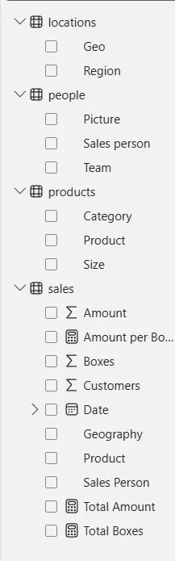
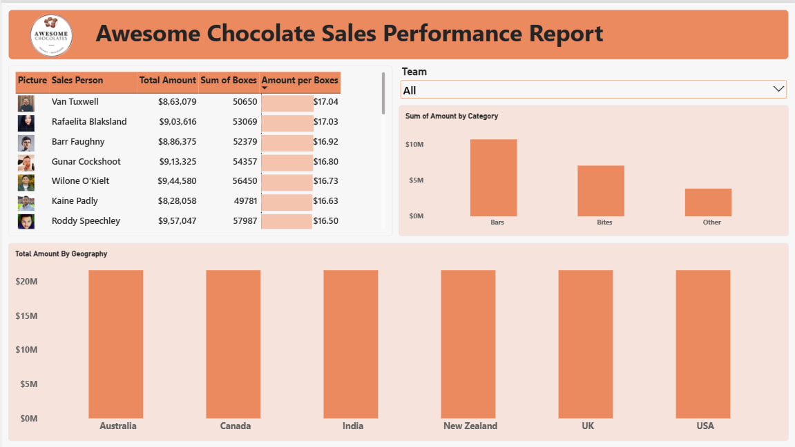

# Day 02: Data Cleaning, Data Modeling and My First Dashboard

**Source:** Beginner to PRO Data Analysis with Power BI (Full Length Course, with sample files)
**Dataset:** Awesome Chocolates (4000+ rows across 4 tables: sales, locations, products, people)

## What I did today

1. Imported the data from Excel files
2. Cleaned and transformed it in Power Query
3. Connected the tables using the Data Model
4. Built charts, a table and a slicer
5. Combined everything into a dashboard and styled it
6. Learned the basics of trend analysis and forecasting

## 1. Importing and cleaning data (Power Query)

The raw data was not ready for analysis, so I cleaned it before loading:

- Removed errors
- Removed empty rows, columns and cells
- Removed duplicate (redundant) data
- Converted the data into a proper, usable form

**Why Power Query is useful:** the original Excel file is never changed. All my cleaning steps are saved and run again automatically whenever the data is refreshed.

## 2. My data tables

| Table | Columns |
|-------|---------|
| locations | Geo, Region |
| people | Picture, Sales person, Team |
| products | Category, Product, Size |
| sales | Amount, Boxes, Customers, Date, Geography, Product, Sales Person |

I also created 3 **measures** (the calculator icons in the picture): Total Amount, Total Boxes and Amount per Box.

## 3. Data modeling (connecting the tables)

Different tables need to be connected so that one chart can use data from many tables, for example showing sales amount by product category.

- Power BI connects tables automatically when the column names match
- When names are different (like Geography and Geo), I have to create the relationship myself
- Relationships are usually one-to-many (one product appears in many sales rows)
- Filter direction decides which table filters which

## 4. Dashboard: Awesome Chocolate Sales Performance Report

**What is on the dashboard:**

| Element | What it shows |
|---------|---------------|
| Table | Sales person with photo, Total Amount, Sum of Boxes and Amount per Box (sorted from highest to lowest Amount per Box) |
| Slicer (dropdown) | Filter the whole report by Team |
| Column chart | Sum of Amount by Category (Bars, Bites, Other) |
| Column chart | Total Amount by Geography (Australia, Canada, India, New Zealand, UK, USA) |

**Formatting I applied:**

- Custom formatting on every visual (titles, fonts, backgrounds)
- One consistent orange color theme that matches the Awesome Chocolates logo
- Data bars inside the Amount per Box column, so I can compare sales people at a glance
- Sales person photos using image URLs
- Header with the company logo and report title

**Interaction:** all visuals are connected. Selecting a team in the slicer updates the table and both charts together.

## 5. Trend analysis and forecasting

- Learned how to add a trend line and a forecast to a time-based chart using the Analytics pane
- The forecast uses only past patterns of the data, it does not know anything about the real business
- So forecasts are a rough guide only, not a promise

## Key takeaways

- Clean the data first, because a dashboard is only as good as its data
- Correct relationships between tables are the base of every correct chart
- Good formatting makes the same data much easier to read
- Slicers make a dashboard interactive for the user

## To check / improve

- In "Total Amount by Geography" all six countries show the same bar height. I need to check the relationship between Geography (sales) and Geo (locations) in Model view.
- The "Other" category in the category chart: find out what is inside it

## Files in this folder

- README.md (these notes)
- report.pbix (my Day 2 report)
- dashboard.png
- data-pane.png
